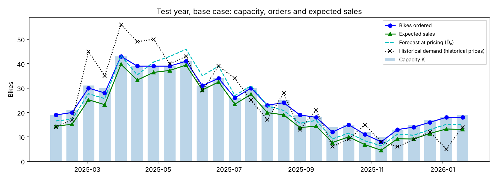

# Bike demand forecasting, pricing and capacity planning

A bike retailer has to reserve supplier capacity weeks ahead, then set prices and order quantities for three models just before each two-week selling period. This project builds the forecast, the customer choice model and the decision rule, and tests them on a full year without using any information that would not have been available at each decision date.

## Approach
1. **Demand forecast.** Regression on lagged demand and seasonality, re-estimated on an expanding window at every decision date (rolling origin), compared with a seasonal-naive benchmark.
2. **Which bike a customer buys.** Multinomial logit on price, validated out of sample on later transactions.
3. **Two-stage decision.** Capacity is reserved first with only older data; prices and integer quantities are set later with fresher data. Expected revenue uses E[min(order, demand)] with simulated forecast errors; unsold units are salvaged.
4. **Checks.** Fixed vs re-estimated parameters, an error hold-out split, grid density and one-way sensitivity to cost assumptions.

## Results
- Forecast mean absolute error **17% lower** than the seasonal-naive benchmark.
- Choice model **88% accurate** on 528 out-of-sample transactions.
- Simulated expected profit **$0.82M vs $0.23M** with baseline prices.

The transaction data was provided under course terms and is not included. Code is available on request.

**Tools:** Python, pandas, statsmodels, scikit-learn, NumPy, matplotlib. A Django wrapper app was also built for the analysis.
