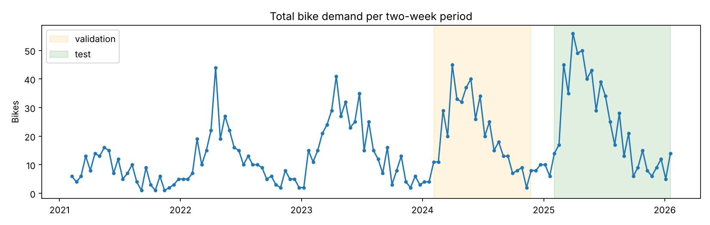
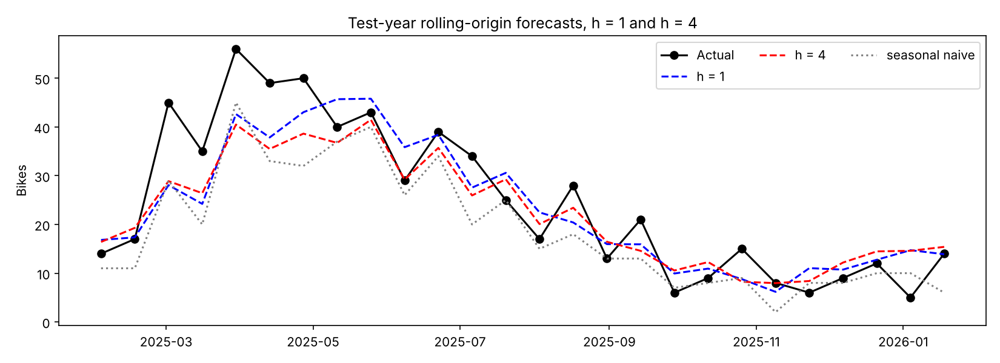

# Bike demand forecasting, pricing and capacity planning

A bike retailer sells three models (Comfort Mountain, Tough Track, Ultimate Mountain). It has to reserve supplier capacity about two months ahead, then set prices and order quantities just before each two-week selling period. This project builds the demand forecast, a model of which bike a customer chooses at given prices, and a two-stage decision rule, then tests the whole pipeline over a full year using only information that would have been available at each decision date.

**Read the full analysis:** [notebook (HTML)](https://sylvmeng.github.io/portfolio/projects/01-bike-demand-pricing/bike_demand_pricing.html) · [notebook (.ipynb)](bike_demand_pricing.ipynb) · [script (.py)](bike_demand_pricing.py) · [Django app](django_app)

## 1. Forecasting demand
Bi-weekly demand is strongly seasonal. I compared four regression specifications on a validation year, each re-estimated at every forecast origin (rolling origin, expanding window), against a seasonal-naive benchmark (same period last year).

| Model | Mean MAE (validation year) |
|---|---|
| **Trend + annual sine/cosine + recent lags + same period last year (chosen)** | **3.96** |
| Two Fourier pairs + lags | 4.12 |
| Two Fourier pairs + last year | 4.27 |
| Seasonal naive (lag 26) | 4.77 |
| Trend + lag 26 | 4.99 |

On the test year, the chosen model's MAE is 12–14% lower than seasonal naive at every horizon from 1 to 4 periods ahead (about 17% on the validation year).

## 2. Which bike does a customer choose?
A multinomial logit on price, trained on earlier transactions and tested on 528 later ones.

| Metric | Value |
|---|---|
| Out-of-sample accuracy | 87.9% |
| Log loss, logit | 0.307 |
| Log loss, historical-share benchmark | 1.100 |

At reference prices ($4,200 / $1,950 / $500) the predicted choice shares are 18% / 30% / 52%.

## 3. Two-stage capacity and pricing decision
- **Stage 1 (start of period t−4):** reserve total capacity using demand data up to t−5. Each reserved unit carries a deposit that is credited if used and forfeited if not.
- **Stage 2 (start of period t−1):** set prices and integer order quantities per model, using data up to t−2.
- Expected revenue uses E[min(order, demand)] with demand drawn from rolling out-of-sample forecast errors and choices drawn from the logit. Unsold bikes are salvaged at 50% of cost.
- Every parameter is re-estimated on data available before each decision date.

| Test year | Optimized prices | Fixed reference prices |
|---|---|---|
| Capacity reserved | 641 | 574 |
| Expected sales (bikes) | 529 | 493 |
| Expected revenue | $2.26M | $0.80M |
| **Expected profit** | **$0.82M** | **$0.23M** |

The optimizer shifts volume toward the high-margin Comfort Mountain and pushes the other two models to the top of the allowed price range.

## Robustness checks
- Rolling vs fixed training parameters: capacity 641 vs 624; the fixed-parameter forecasts were slightly more accurate.
- Error samples split into two halves to measure regret rather than in-sample optimism.
- Price grid density and one-way sensitivity to deposit, salvage and cost assumptions. A deposit above $162.50 per unit makes ordering and salvaging cheaper than forfeiting, which is a limit of the contract assumptions.

## Data
The transaction data was provided under course terms and is not included, so the code will not run without it. The cost and contract parameters are stated assumptions, not supplier quotes.

**Tools:** Python, pandas, NumPy, statsmodels, scikit-learn, matplotlib, Django.
