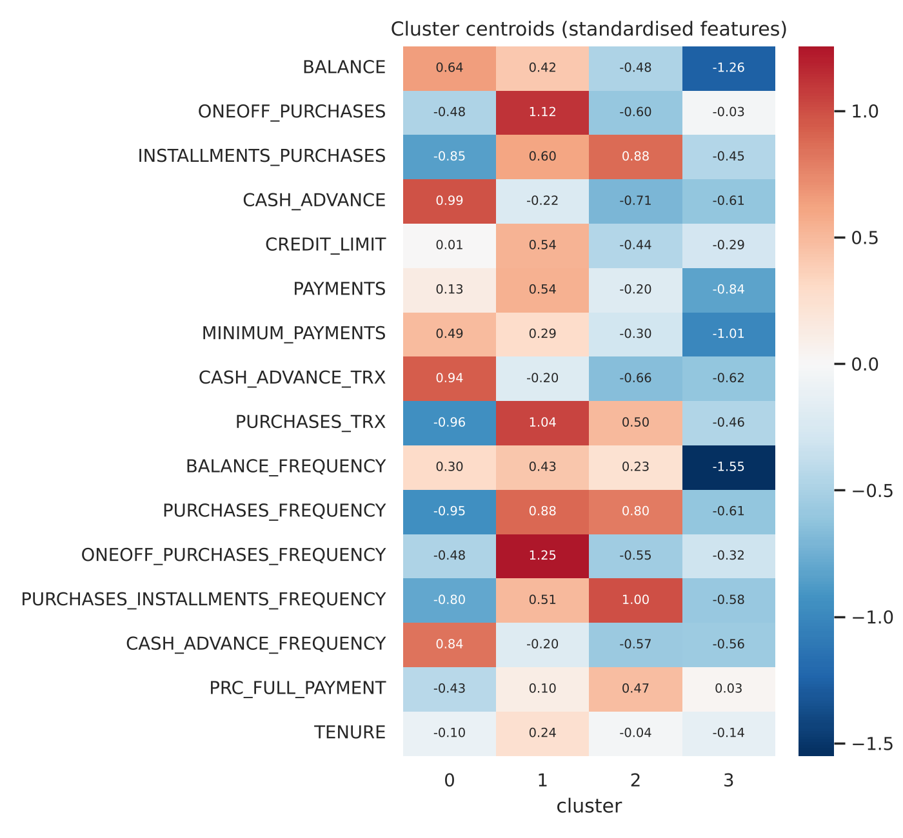

# Credit card customer segmentation

Groups 8,950 credit card holders by how they use their cards, so marketing can target offers by behaviour rather than by balance alone.

## Approach
- **Preparation:** imputed missing minimum payments by balance decile, capped impossible frequencies, dropped a redundant total, log-transformed skewed amounts and counts, standardized, PCA for visualisation.
- **Methods compared:** K-Means, hierarchical (Ward), Gaussian mixture and DBSCAN, choosing *k* with the elbow, silhouette and Davies–Bouldin scores.
- **Stability:** bootstrap resampling (adjusted Rand index) and checks on how much the segments depend on imputation and capping choices.

## Results
Four K-Means segments, stable under resampling (ARI 0.98):

| Segment | Share | Profile |
|---|---|---|
| Cash-advance revolvers | 33% | High balances, heavy cash advances, few purchases |
| Active spenders | 27% | Frequent one-off and instalment purchases, high limits and payments |
| Instalment buyers | 23% | Regular instalment purchases, more often pay in full |
| Low activity | 17% | Low balances and little activity |

The notebook also lists the prospective tests (retention, response to offers) needed to show business value, since in-sample differences between clusters do not prove it.

**Data:** public Kaggle dataset [Customer Segmentation Data](https://www.kaggle.com/datasets/hashemi221022/customer-segmentation-data) (`Customer_Data.csv`). Code is available on request.

**Tools:** Python, pandas, scikit-learn, SciPy, matplotlib, seaborn.
