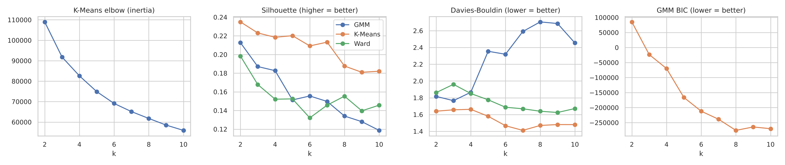
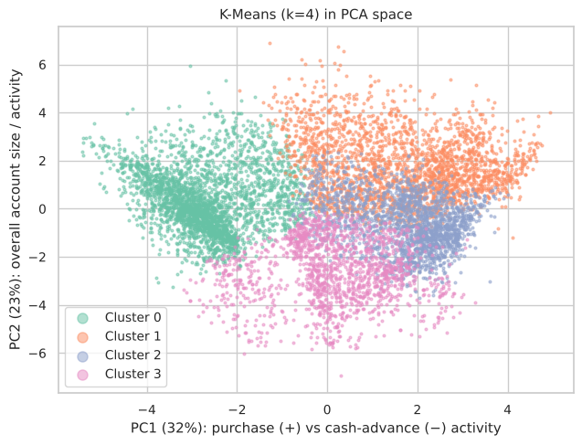

# Credit card customer segmentation

Groups 8,950 credit card holders by how they use their cards, so a card issuer can target offers by behaviour rather than by balance alone.

**Read the full analysis:** [notebook (HTML)](https://sylvmeng.github.io/portfolio/projects/02-credit-card-segmentation/credit_card_segmentation.html) · [notebook (.ipynb)](credit_card_segmentation.ipynb) · [script (.py)](credit_card_segmentation.py)

**Data:** public Kaggle dataset [Customer Segmentation Data](https://www.kaggle.com/datasets/hashemi221022/customer-segmentation-data) (`Customer_Data.csv`, 8,950 × 18). Download it next to the notebook to run it.

## 1. Preparing the data
- Dropped the one row with a missing credit limit; imputed missing minimum payments with the median of the customer's balance decile.
- Capped a cash-advance frequency field at 1 (values above 1 are impossible for a share).
- Dropped total purchases because it is the sum of one-off and instalment purchases.
- Log-transformed skewed amounts and counts, standardized all 16 features. PCA: 7 components explain 89% of variance.

## 2. Choosing a method and the number of segments
Compared K-Means, hierarchical (Ward), Gaussian mixture and DBSCAN across *k*, using the elbow, silhouette and Davies–Bouldin scores plus subsampling stability.

- **K-Means, k = 4** was chosen: best balance of separation (silhouette 0.22) and stability (bootstrap ARI 0.98).
- Ward was the least stable under subsampling (ARI 0.34–0.60).
- DBSCAN mostly labelled short-tenure, low-payment accounts as noise rather than finding new groups.

## 3. The four segments

| Segment | Share | What sets it apart | Offer idea |
|---|---|---|---|
| Cash-advance revolvers | 33% | High balances, heavy cash advances, few purchases | Balance-transfer or instalment conversion; watch credit risk |
| Active spenders | 27% | Frequent one-off and instalment purchases, high limits and payments | Rewards and limit increases |
| Instalment buyers | 23% | Regular instalment purchases, most likely to pay in full | Instalment promotions with partner merchants |
| Low activity | 17% | Low balances, little use | Activation offers, or reduce servicing cost |

## 4. How much to trust the segments
- Labels barely change with a different imputation (ARI 0.99) or without the cap.
- The cash-advance segment is robust (about 43% either way); the low-activity segment is sensitive to imputation (26% → 17%).
- Differences between clusters are in-sample descriptions. Showing business value needs a prospective test, e.g. freezing assignments and tracking 12-month retention and offer response by segment.

**Tools:** Python, pandas, scikit-learn, SciPy, matplotlib, seaborn.
