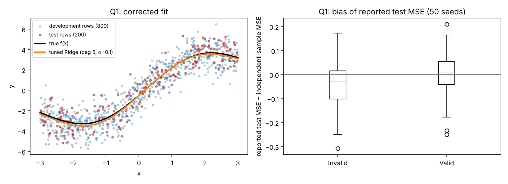
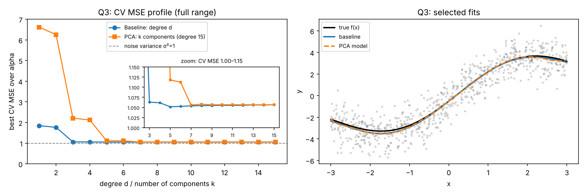

# Leakage-safe model tuning and PCA trade-offs

Two common modelling mistakes, measured instead of just described. Everything runs as-is: simulated data and scikit-learn's Iris.

**Read the full analysis:** [notebook (HTML)](https://sylvmeng.github.io/portfolio/projects/04-model-tuning-leakage-pca/model_tuning_leakage_pca.html) · [notebook (.ipynb)](model_tuning_leakage_pca.ipynb) · [script (.py)](model_tuning_leakage_pca.py)

## 1. What happens when the test set is used for tuning
Data: y = f(x) + noise with a smooth non-linear f, 1,000 rows. Model: polynomial features → scaling → ridge, tuned over degree and α.

| Setup | Chosen model | Reported test MSE |
|---|---|---|
| Leaky: hyperparameters picked on the test set | degree 3, α = 0.1 | 1.016 |
| Correct: 5-fold CV on development data, test set used once | degree 5, α = 0.1 | 1.035 (CV 1.052) |

One split can't tell luck from bias, so I repeated both setups over **50 random seeds** and compared each reported test error with an independent-sample estimate. The leaky setup understates error by **0.045 on average (SE 0.013)**; the correct setup is close to zero.

## 2. Does PCA help a classifier?
Logistic regression on Iris (PCA on centred features):

| Features | Weighted F1 |
|---|---|
| All 4 original | 0.967 |
| First 2, 3 or 4 PCs | 0.967 |
| First PC only | 0.933 |

Two components keep all the predictive information; one loses some.

## 3. Does PCA help a ridge regression?
Adding PCA before ridge in the regression above:

| Model | CV MSE |
|---|---|
| Baseline (degree 5, α = 0.1) | 1.0516 |
| Degree 15 + PCA (7 components) | 1.0561 |
| Degree 15, no PCA | 1.0567 |

Compared fold by fold, the PCA model is worse by 0.0045 on average (SD 0.0054) and the baseline wins 3 of 5 folds, so the difference is within noise. PCA adds a step without improving accuracy here.

**Tools:** Python, scikit-learn (Pipeline, GridSearchCV, KFold, PCA), NumPy, pandas, matplotlib.
