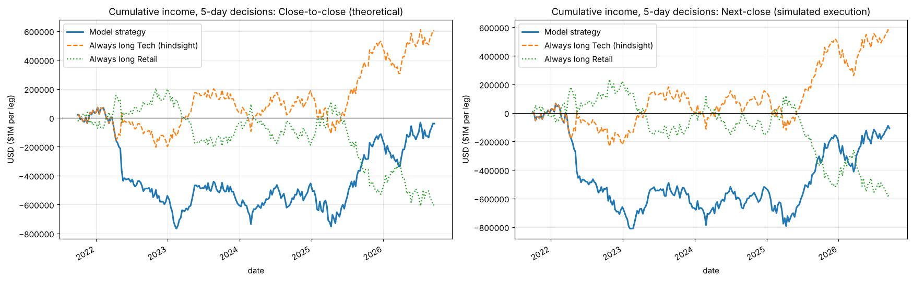
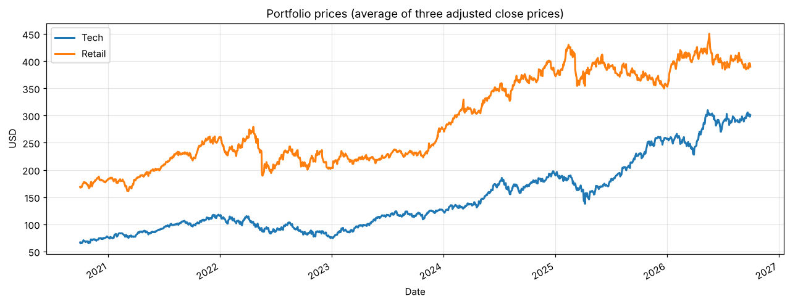

# Can a forecast time tech vs retail? A long/short backtest

Two equal-weight stock baskets, tech (GOOG, NVDA, AAPL) and retail (WMT, COST, TGT), with six years of daily adjusted prices from Yahoo Finance (Oct 2020 to Sep 2026). Every five trading days a time-series model forecasts both baskets, and the strategy goes long $1M of the one with the higher expected return and short $1M of the other. The question is whether the forecast adds anything a simple buy-and-hold would not.

Full report: [report.pdf](report.pdf)

## Approach
- **Model selection:** ACF/PACF, ADF and KPSS tests, then ARIMA candidates compared by AIC on the first year only. A random walk with drift won for both baskets, so the forecast is essentially the recent average return.
- **No look-ahead:** each decision uses data up to that day only. Trades are filled at the next day's close, the version a trader could actually execute; same-day fills are kept as a reference.
- **Uncertainty:** block-bootstrap intervals for total income, a hindsight comparison with always holding tech (HAC t-test), start-date shifts and a transaction-cost check.

## What I found
- The strategy **lost $109,512** before costs over 250 decisions, and the 95% interval (−$1.36M to +$1.15M) includes zero.
- The forecast favoured tech in 237 of 250 periods and picked the better basket only 48–50% of the time.
- **The result depends on the start date.** Starting 1–4 trading days later turns it into a gain of $137K to $488K.
- The whole gap to always-long-tech comes from the 13 periods that went long retail, and two of those account for about 60% of it. The gap is not statistically significant (t = −1.62).
- At one basis point of cost per leg per trade, the loss grows to about $210K.

**Takeaway:** a single backtest total is a weak basis for a trading decision. Execution timing, start date and costs each move the answer more than the model does, so they need to be checked before trusting any number like this.

**Tools:** Python, pandas, statsmodels (ARIMA, ADF/KPSS, HAC), yfinance, matplotlib.
